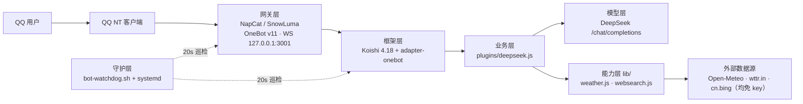

# AgentTalk

> 把 QQ 群聊接入大模型的**最小可运维**工程：Koishi 插件 + 网关契约 + 部署/迁移留痕。
> 生产网关：**NapCat**（因账号风控 168 暂停）；目标网关：**SnowLuma v2.2.1**，
> 用官方 release 包 + ubuntu:24.04 容器承载（宿主 glibc 2.31 不够原生层用）。

本仓库只存放**自有代码与文档**。Koishi、NapCat、SnowLuma、QQ 客户端等第三方组件一律**外链引用**，
不入库（详见 [`docs/05-external-links.md`](docs/05-external-links.md)）。

---

## 架构



| 层 | 组件 | 是否入库 |
|---|---|---|
| 网关层 | NapCat（现 + 回滚路径） / SnowLuma v2.2.1（目标，容器内） | ❌ 外链 |
| 框架层 | Koishi + adapter-onebot | ❌ 外链（仅保留 `package.json` 钉版本） |
| 业务层 | `bot/plugins/deepseek.js`（编排 + 模型循环）+ `bot/lib/*.js`（8 个能力/基础模块） | ✅ |
| 运维层 | 守护脚本 / systemd / 迁移脚本 | ✅ |
| 配置 | `config/`（仅模板，真实值不入库） | ✅ 模板 |

---

## 仓库结构

```
AgentTalk/
├── bot/                      # 业务层（部署到 /opt/koishi）
│   ├── koishi.config.js      # 全部参数取自环境变量，无硬编码
│   ├── package.json          # 依赖 + overrides（复现 satori 版本冲突修复）
│   ├── lib/                  # 能力与基础件（11-02 拆分；**不能**放进 plugins/，否则会被当插件装载）
│   │   ├── weather.js        # 天气：Open-Meteo 主 + wttr.in 兜底 + 地理编码缓存
│   │   ├── websearch.js      # 搜索：查询词归一化 + 去重 + 结果质量闸
│   │   ├── tools.js          # 工具注册表（能力挂载与分发，能力声明与此同源）
│   │   ├── hotconfig.js      # bot.env 热配置层（改值秒级生效）
│   │   ├── store.js          # 多轮上下文与 token 用量落盘
│   │   ├── sender.js         # 频率闸 + 文本整形 + OneBot 投递路由
│   │   ├── quote.js          # 引用原文三层兜底
│   │   └── text.js           # 纯文本工具 / 时间注入
│   └── plugins/
│       └── deepseek.js       # 插件主体：消息流编排 + 模型调用循环（不堆能力进来）
├── config/
│   ├── bot.env.example       # 运行时配置模板（初始状态，无密钥）
│   └── napcat/               # 网关配置样例（token 已脱敏）
├── docs/
│   ├── 01-architecture.md    # 架构与关键机制
│   ├── 02-operations.md      # 运维手册（启动/重启/验证）
│   ├── 03-dev-log.md         # 开发改造全记录（逐日追加，现至第二十节）
│   ├── 04-migration-snowluma.md # 网关迁移方案（路线 B）
│   ├── 05-external-links.md  # 第三方项目外链与许可说明
│   ├── 06-snowluma-todo.md   # SnowLuma 收尾待办（P0~P3）
│   └── decisions/            # ADR：关键决策留痕
├── ops/
│   ├── bot-watchdog.sh       # 进程守护（支持 BOT_GATEWAY 切换）
│   ├── snowluma/             # SnowLuma 部署（setup / start / container/）
│   ├── launcher.napcat.sh.example # NapCat 拉起（含快速登录 / 废锁清理）
│   ├── s0-verify.sh          # S0 自检（只读，可当 W2 闸门）
│   ├── systemd/              # unit 文件
│   └── migrate/              # 一键切换 / 一键回滚
└── scripts/
    ├── botctl.sh             # 统一运维入口（status/restart/sync/verify/gate）
    ├── smoke-plugin.js       # 插件级冒烟测试（不发消息、不碰线上状态目录）
    └── export-from-server.sh # 从生产机导出并脱敏后同步回仓库
```

---

## 快速开始（从零部署）

```bash
# 1) 第三方组件（外链，需自行安装）
#    Koishi  → /opt/koishi
#    NapCat  → /opt/napcat + /opt/QQ（注入式启动）

# 2) 本仓库代码
git clone https://github.com/bakamalu/AgentTalk.git
cp -r AgentTalk/bot/*            /opt/koishi/    # 含 lib/ → /opt/koishi/lib/
cp    AgentTalk/ops/bot-watchdog.sh /opt/

# 3) 配置（真实值只存在服务器上）
cp AgentTalk/config/bot.env.example /root/deploy/bot.env
chmod 600 /root/deploy/bot.env        # 含密钥，必须 600
vim  /root/deploy/bot.env             # 填 API Key / QQ 号 / WS token

# 4) 环境变量引导链
#    /etc/profile → /root/deploy/profile → /root/deploy/bot.env

# 5) 依赖（注意 overrides，否则 satori 版本冲突）
cd /opt/koishi && npm install

# 6) 守护
cp AgentTalk/ops/systemd/qqbot-watchdog.service /etc/systemd/system/
systemctl daemon-reload && systemctl enable --now qqbot-watchdog
```

验证方式见 [`docs/02-operations.md`](docs/02-operations.md)（**不要只看进程/端口存在**）。

---

## SnowLuma（容器模式）速查

```bash
# 1) 解压官方 release 包到 /opt/snowluma（自带 node 24，不用装运行时）
# 2) 生成配置（onebot.json / runtime.json / snowluma.env，600）
sudo ./ops/snowluma/setup.sh
# 3) 建镜像（ubuntu:24.04 + QQ 运行库 + Xvfb + x11vnc）
sudo docker build -t qqbot/snowluma:2.2.1 ops/snowluma/container/
# 4) 起容器（QQ + supervisor 同容器；--network host 保持回环）
sudo ./ops/snowluma/container/run.sh up
sudo ./ops/snowluma/container/run.sh status
```

要点（细节见 [`docs/04-migration-snowluma.md`](docs/04-migration-snowluma.md) 附录 A）：

- SnowLuma 不是 `LD_PRELOAD`，而是先有 QQ、再由 supervisor `ptrace`+`dlopen` 注入，
  所以容器需要 `--cap-add=SYS_PTRACE` + `seccomp=unconfined`。
- 登录二维码在 **QQ 自己的 X 窗口**里，无头机需要 `SNOWLUMA_VNC=1` 临时开 x11vnc
  （只听 `127.0.0.1:5900`，走 SSH 隧道看屏扫码）。
- 首次启动前**不能**存在 `config/webui.json`，否则 `SNOWLUMA_WEBUI_BOOTSTRAP_PASSWORD` 不生效。
- 闸门：`./ops/s0-verify.sh`（第 10 组就是 SnowLuma 的 14 项断言）。

收尾清单（风控解除后按顺序做）见 [`docs/06-snowluma-todo.md`](docs/06-snowluma-todo.md)。

---

## 密钥与隐私策略

- 真实配置（API Key、WS Token、QQ 号、服务器 IP）**只存在于 `/root/deploy/bot.env`（600）**，
  永不入库。仓库里的 `bot.env.example` 是**初始状态模板**。
- 文档中的 QQ 号 / IP / Token 一律用 `<BOT_UIN>` `<SERVER_IP>` `<WEBUI_TOKEN>` 等占位符。
- 提交前自查：

  ```bash
  git diff --cached | grep -nE "sk-[A-Za-z0-9]{20,}|[0-9]{9,10}|[0-9]{1,3}(\.[0-9]{1,3}){3}"
  ```

- 若不慎泄露：**先吊销 Key**，再考虑用 `git filter-repo` 清理历史（历史里的密钥视为已失效）。

---

## 迁移状态

| 阶段 | 状态 |
|---|---|
| 网关选型分析 | ✅ [`external/snowluma-analysis.md`](external/snowluma-analysis.md) |
| 迁移路线 B 细化 | ✅ [`docs/04-migration-snowluma.md`](docs/04-migration-snowluma.md) |
| S0 前置对齐 | ✅ `ops/s0-verify.sh` 37 项全绿（含 SnowLuma 第 10 组） |
| 容器化改造 | ✅ `ops/snowluma/container/`（ubuntu:24.04 承载 QQ + SnowLuma，glibc 2.39） |
| W0 冷启动演练 | ✅ WebUI 5099 正常，原生层无 `GLIBCXX` 报错 |
| W1 试切窗口 | 🟡 注入链路已验证（`hook auto-load` + `pipe connected`），登录卡在账号风控 168 |
| W2 正式切换 | ⬜ 待手机端解除风控后一次合法登录（收尾步骤见 [`docs/06-snowluma-todo.md`](docs/06-snowluma-todo.md)） |

### S0 已完成项（2026-10-30）

| 项 | 做法 | 验证 |
|---|---|---|
| 全量备份 + state 快照 | `/root/deploy/migrate/<TS>/`（含 `MANIFEST.sha256`、`state-deepseek/`），`current` 软链指向最新 | `ops/s0-verify.sh` 第 6 组 |
| WS token 两侧对齐 | 同值写入 NapCat `onebot11_*.json` 与 `/root/deploy/bot.env`，Koishi 走 `process.env.NAPCAT_WS_TOKEN` | 第 2 组 |
| 收回回环 | NapCat WS `0.0.0.0` → `127.0.0.1`，WebUI `::` → `127.0.0.1` | 第 3 组 |
| 一键切换/回滚 | `ops/migrate/switch-to-snowluma.sh`、`rollback-to-napcat.sh`，均支持 `--dry-run` | 手动跑 dry-run |
| 守护可切网关 | 线上 watchdog 升级为支持 `BOT_GATEWAY`，systemd `KillMode` 由 `process` 改 `mixed` | 第 5 组 |
| 掉登录态自愈 | `launcher.sh` 支持 `NAPCAT_QUICK_LOGIN`（转 `-q`），不再卡二维码 | 第 4 组 |

一键自检（只读，失败返回非 0，可直接当 W2 闸门）：

```bash
./ops/s0-verify.sh
```

> 踩坑留痕：`Xvfb` 被 SIGKILL 后 `/tmp/.X99-lock` 残留，`xvfb-run -a` 拿到脏显示号会让 QQ 直接
> `SIGILL` 崩溃循环。`launcher.sh` 现在启动前会清理高位显示号的尸体锁（仅当无人持有该 socket）。

---

## 许可

自有代码：见 [`LICENSE`](LICENSE)。
第三方组件（SnowLuma 为 **source-available 非商业许可**，不是 OSI 开源）各自遵循其原许可，
本仓库不包含其源码，仅作外链引用与行为分析。
