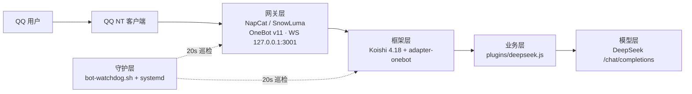

# AgentTalk

> 把 QQ 群聊接入大模型的**最小可运维**工程：Koishi 插件 + 网关契约 + 部署/迁移留痕。
> 当前生产网关为 **NapCat**，正在按路线 B 灰度迁移到 **SnowLuma**。

本仓库只存放**自有代码与文档**。Koishi、NapCat、SnowLuma、QQ 客户端等第三方组件一律**外链引用**，
不入库（详见 [`docs/05-external-links.md`](docs/05-external-links.md)）。

---

## 架构



| 层 | 组件 | 是否入库 |
|---|---|---|
| 网关层 | NapCat（现） / SnowLuma（迁移中） | ❌ 外链 |
| 框架层 | Koishi + adapter-onebot | ❌ 外链（仅保留 `package.json` 钉版本） |
| 业务层 | `bot/plugins/deepseek.js` | ✅ |
| 运维层 | 守护脚本 / systemd / 迁移脚本 | ✅ |
| 配置 | `config/`（仅模板，真实值不入库） | ✅ 模板 |

---

## 仓库结构

```
AgentTalk/
├── bot/                      # 业务层（部署到 /opt/koishi）
│   ├── koishi.config.js      # 全部参数取自环境变量，无硬编码
│   ├── package.json          # 依赖 + overrides（复现 satori 版本冲突修复）
│   └── plugins/
│       └── deepseek.js       # 核心插件：上下文/名单/频率闸/热配置/媒体占位
├── config/
│   ├── bot.env.example       # 运行时配置模板（初始状态，无密钥）
│   └── napcat/               # 网关配置样例（token 已脱敏）
├── docs/
│   ├── 01-architecture.md    # 架构与关键机制
│   ├── 02-operations.md      # 运维手册（启动/重启/验证）
│   ├── 03-dev-log.md         # 开发改造全记录（19 项修复的来龙去脉）
│   ├── 04-migration-snowluma.md # 网关迁移方案（路线 B）
│   ├── 05-external-links.md  # 第三方项目外链与许可说明
│   └── decisions/            # ADR：关键决策留痕
├── ops/
│   ├── bot-watchdog.sh       # 进程守护（支持 BOT_GATEWAY 切换）
│   ├── launcher.napcat.sh.example
│   ├── systemd/              # unit 文件
│   └── migrate/              # 一键切换 / 一键回滚
└── scripts/
    └── export-from-server.sh # 从生产机导出并脱敏后同步回仓库
```

---

## 快速开始（从零部署）

```bash
# 1) 第三方组件（外链，需自行安装）
#    Koishi  → /opt/koishi
#    NapCat  → /opt/napcat + /opt/QQ（注入式启动）

# 2) 本仓库代码
git clone https://github.com/bakamalu/AgentTalk.git
cp -r AgentTalk/bot/*            /opt/koishi/
cp    AgentTalk/ops/bot-watchdog.sh /opt/

# 3) 配置（真实值只存在服务器上）
cp AgentTalk/config/bot.env.example /root/deploy/bot.env
chmod 600 /root/deploy/bot.env        # 含密钥，必须 600
vim  /root/deploy/bot.env             # 填 API Key / QQ 号 / WS token

# 4) 环境变量引导链
#    /etc/profile → /root/deploy/profile → /root/deploy/bot.env

# 5) 依赖（注意 overrides，否则 satori 版本冲突）
cd /opt/koishi && npm install

# 6) 守护
cp AgentTalk/ops/systemd/qqbot-watchdog.service /etc/systemd/system/
systemctl daemon-reload && systemctl enable --now qqbot-watchdog
```

验证方式见 [`docs/02-operations.md`](docs/02-operations.md)（**不要只看进程/端口存在**）。

---

## 密钥与隐私策略

- 真实配置（API Key、WS Token、QQ 号、服务器 IP）**只存在于 `/root/deploy/bot.env`（600）**，
  永不入库。仓库里的 `bot.env.example` 是**初始状态模板**。
- 文档中的 QQ 号 / IP / Token 一律用 `<BOT_UIN>` `<SERVER_IP>` `<WEBUI_TOKEN>` 等占位符。
- 提交前自查：

  ```bash
  git diff --cached | grep -nE "sk-[A-Za-z0-9]{20,}|[0-9]{9,10}|[0-9]{1,3}(\.[0-9]{1,3}){3}"
  ```

- 若不慎泄露：**先吊销 Key**，再考虑用 `git filter-repo` 清理历史（历史里的密钥视为已失效）。

---

## 迁移状态

| 阶段 | 状态 |
|---|---|
| 网关选型分析 | ✅ [`external/snowluma-analysis.md`](external/snowluma-analysis.md) |
| 迁移路线 B 细化 | ✅ [`docs/04-migration-snowluma.md`](docs/04-migration-snowluma.md) |
| S0 前置对齐 | ⬜ 待执行 |
| W0 冷启动演练 | ⬜ |
| W1 试切窗口 | ⬜ |
| W2 正式切换 | ⬜ |

---

## 许可

自有代码：见 [`LICENSE`](LICENSE)。
第三方组件（SnowLuma 为 **source-available 非商业许可**，不是 OSI 开源）各自遵循其原许可，
本仓库不包含其源码，仅作外链引用与行为分析。
