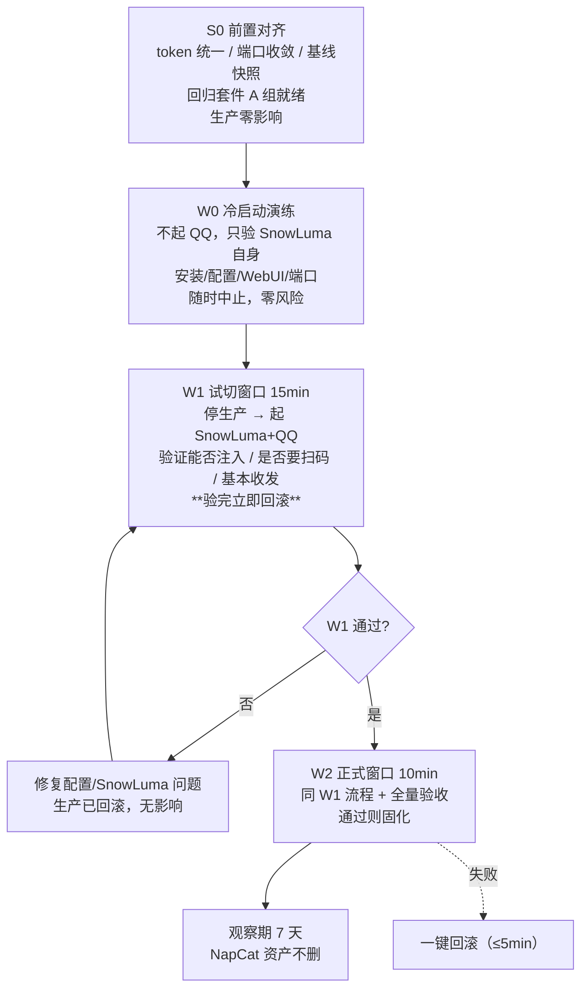

# SnowLuma 迁移 · 路线 B 细化（免小号 / 窗口式可回滚灰度）

> 编写时间：2026-10-30
> 上游基线：SnowLuma v2.2.1（`8ffd314`）
> 源码来源：`https://github.com/bakamalu/SnowLuma.git`（fork）
> 方式：**不开小号**，用"冷启动演练 → 试切窗口 → 正式窗口"三段式，每段都可 5 分钟回滚
> 硬约束不变：Koishi + `deepseek.js` **零改动**；19 项历史修复**零回归**

---

## 0. 先说清楚：fork 构建是怎么回事

### 0.1 你的 fork 现状（实测）

| 项 | 实测值 |
|---|---|
| 仓库 | `bakamalu/SnowLuma`，`fork: true` |
| 默认分支 | `main` |
| 与上游关系 | **up to date with `SnowLuma/SnowLuma:main`**（无自有提交） |
| 最新提交 | `8ffd314` `chore(release): v2.2.1` |
| 自有 Release | **无**（`has_downloads: false`） |
| 创建时间 | 2026-10-30T02:56:32Z |

**结论**：现在从 fork 构建 == 从上游 v2.2.1 构建，产物完全等价，
唯一区别是"多花 30 分钟编译"。所以真正的决策不是"fork 还是上游"，
而是"**要不要为了将来的私人改动保留一条源码构建通道**"。

### 0.2 源码构建的两个硬门槛

| 门槛 | 要求 | 本机 | 处理 |
|---|---|---|---|
| Node | **24+**（README/`.node-version`） | v22.11.0 | 装独立 `/opt/node24`，**不动系统 node**（Koishi 依赖 22） |
| pnpm | 11.25.0 | **未安装** | `corepack prepare pnpm@11.25.0 --activate` |
| 网络 | github.com **直连不通**（`000`） | codeload `301` / gh-proxy `200` / npmmirror `200` | 走镜像 |
| 原生组件 | `wrapper.linux.node` 等**不在源码树内** | — | **必须从发行包取** |

### 0.3 三种制品方案对比

| 方案 | 做法 | 优点 | 缺点 | 采用 |
|---|---|---|---|---|
| **P1 纯发行包** | 下载 `SnowLuma-v2.2.1-linux-x64.tar.gz` | 最稳、内置 Node、原生组件齐全 | 无 fork 定制 | ✅ **W0~W2 用这个** |
| **P2 混合** | 发行包原生层 + fork 源码编译出的 JS 层 | 保留私有改动能力 | 需维护两套、升级时要重放补丁 | ✅ fork 一旦有改动就用这个 |
| **P3 纯源码** | `pnpm build` 全量 | 最"干净" | **缺原生注入层，大概率起不来** | ❌ 不采用 |

**推荐落地**：
```
/opt/snowluma/                  ← 发行包解压（含原生组件 + 内置 Node）
/opt/snowluma-src/              ← fork 源码 clone（仅阅读/打补丁/比对）
/opt/snowluma-js-layer/         ← 仅当 fork 有改动时，编译后覆盖过去
```

---

## 1. 环境事实（已实测，方案据此制定）

| 项 | 值 |
|---|---|
| OS / 架构 | Ubuntu 20.04 / x86_64 |
| 系统 Node | v22.11.0（`/usr/local/lib/nodejs/node-v22.11.0-linux-x64`） |
| pnpm | 缺失 |
| 磁盘 | 21G 可用 |
| 现网 QQ | 3.2.34-53644，`/opt/QQ`，**与 NapCat 同进程**（pid 50359 持 3001/6099） |
| 现网 WS | `0.0.0.0:3001`，`token: ""`，`messagePostFormat: array` |
| 现网 WebUI | `:6099`，`host: "::"`（⚠ 公网可达） |
| Koishi | `:5140` 绑 `127.0.0.1`，watchdog 20s 巡检 |

### 网络通道（决定了下载方式）

```
github.com          → 000  ❌
codeload.github.com → 301  ✅（重定向可用）
gh-proxy.com        → 200  ✅
nodejs.org          → 200  ✅
registry.npmmirror  → 200  ✅
```

### 制品与校验值（官方 v2.2.1）

| 文件 | 大小 | sha256 |
|---|---|---|
| `SnowLuma-v2.2.1-linux-x64.tar.gz` | 52,557,548 | `93a30395c8cc7c39d1061fd1ad841a4382921a6bc7833725857805c4f2e98b4d` |
| `SnowLuma-v2.2.1-linux-x64-lite.tar.gz` | 7,746,432 | `4f98612623eca34b28eac826753ec8e0b32a130f572c06580dc4ae43a6c874d3` |

> 用**完整版**（内置 Node 22 独立运行时），彻底绕开"系统 Node 只有 22"的门槛。
> Lite 版要求 Node 24.22.1+，反而更麻烦。

---

## 2. 阶段总览



关键点：**W1 是"故意浪费"的 15 分钟**。它把"能不能起来、要不要扫码、注入成不成功"
这些最大不确定性，放在生产可随时回滚的前提下先烧掉一次。
路线 B 的全部安全性都来自"W1 先试一次"。

---

## 3. S0：前置对齐（生产零影响，先做）

### S0.1 备份

```bash
TS=$(date +%Y%m%d-%H%M%S); mkdir -p /root/deploy/migrate/$TS
cp /opt/koishi/koishi.config.js /root/deploy/migrate/$TS/
cp /opt/bot-watchdog.sh         /root/deploy/migrate/$TS/
cp /root/deploy/bot.env         /root/deploy/migrate/$TS/
cp /opt/napcat/config/onebot11_<BOT_UIN>.json /root/deploy/migrate/$TS/
cp -a /opt/koishi/state/deepseek /root/deploy/migrate/$TS/state-deepseek
ln -sfn /root/deploy/migrate/$TS /root/deploy/migrate/current
```

### S0.2 WS token 统一（**这一步是 W2 零改动的关键**）

现状 Koishi `token: ''` 是硬编码，NapCat 也是空。若不统一，W2 时必须改 Koishi 配置并重启。

1. 生成固定 token 写入 `bot.env`（值与 NapCat 现有 webui token 无关联，重新生成）：
   `export NAPCAT_WS_TOKEN="<32位随机>"`
2. `/opt/napcat/config/onebot11_<BOT_UIN>.json` → `websocketServers[0].token` 设为同值
3. `/opt/koishi/koishi.config.js` → `token: process.env.NAPCAT_WS_TOKEN || ''`
4. 按 dev 文档第九节流程重启，验证 `adapter connect` 正常

> 建议改完**观察 24 小时**再进 W0。这样 W2 时 Koishi 侧一个字节都不用动。

### S0.3 端口收敛 + 安全顺手修

- NapCat WS `host: 0.0.0.0` → `127.0.0.1`
- NapCat WebUI `host: "::"` → `127.0.0.1`（当前公网可达，属遗留风险）
- 端口保持 `3001`（给 SnowLuma 复用）

### S0.4 基线快照

```bash
mkdir -p /root/deploy/migrate/baseline
ps -eo pid,args | grep -E 'QQ|koishi' > /root/deploy/migrate/baseline/ps.txt
ss -lntup | grep -E ':3001|:5140|:6099' > /root/deploy/migrate/baseline/ports.txt
tail -500 /opt/logs/koishi.log > /root/deploy/migrate/baseline/koishi-tail.log
```

### S0.5 回归套件（拆成两组，B 组要真网关）

**A 组（14 项，mock 驱动，离线跑，随时可跑）**
群聊未@不回 / @后分段 / 白名单正反 / 黑名单压管理员 / 敏感词双向 / 频率闸 /
最小间隔 / 串行队列 / Markdown 转纯文本 / CQ 占位化 / 管理员指令 / 历史持久化往返 /
撤回剔除 / 热配置 hash / @前缓冲与活跃窗口

**B 组（7 项，必须连真网关，只能在 W1/W2 窗口内跑）**
`send_group_msg` 返回 0 / `get_msg` 供 `session.quote` / `message-recall` 定位 /
媒体段名一致 / 未@进缓冲 / 断线重连 / 心跳 30s

**Gate S0**：A 组 14/14 绿 + token 对齐后 24h 无异常。

---

## 4. W0：冷启动演练（不注入 QQ，零风险）

目的：把"装错了/端口配错/配置格式错/起不来"这类**纯安装问题**在碰生产前全部烧掉。

### 4.1 拉取制品

```bash
mkdir -p /opt/dl && cd /opt/dl
U=https://github.com/SnowLuma/SnowLuma/releases/download/v2.2.1/SnowLuma-v2.2.1-linux-x64.tar.gz
curl -L --retry 3 -o sl.tar.gz "https://gh-proxy.com/$U"
echo "93a30395c8cc7c39d1061fd1ad841a4382921a6bc7833725857805c4f2e98b4d  sl.tar.gz" | sha256sum -c -
```

> 校验不过就换 `codeload`/别的镜像重下，**绝不放行未校验的二进制**（这是要注入 QQ 的进程）。

### 4.2 拉取 fork 源码（仅比对/将来打补丁用，不参与 W0 启动）

```bash
git clone https://gh-proxy.com/https://github.com/bakamalu/SnowLuma.git /opt/snowluma-src
cd /opt/snowluma-src
git log --oneline -3                                   # 应为 8ffd314 ...
git remote add upstream https://gh-proxy.com/https://github.com/SnowLuma/SnowLuma.git
git diff --stat upstream/main                          # 空 = 与上游一致
```

### 4.3 解压 + 首次启动（不接 QQ）

```bash
mkdir -p /opt/snowluma && tar -xzf /opt/dl/sl.tar.gz -C /opt/snowluma --strip-components=1
ls /opt/snowluma                                       # 确认 launcher.sh / 内置 node
```

**首次启动必须带无人值守变量**（否则卡在 EULA/隐私同意页）：

```bash
cd /opt/snowluma
SNOWLUMA_ACCEPT_EULA=1 SNOWLUMA_ACCEPT_PRIVACY=1 \
  nohup ./launcher.sh >> /opt/logs/snowluma-w0.log 2>&1 &
sleep 20
grep -iE "password|admin|5099|listening|error" /opt/logs/snowluma-w0.log | head -20
```

### 4.4 配置改为"灰度形态"（关键：端口不与 NapCat 冲突）

```jsonc
// /opt/snowluma/config/onebot_<UIN>.json
{
  "network": {
    "websocketServers": [{
      "name": "koishi",
      "enable": true,
      "host": "127.0.0.1",
      "port": 3101,                    // W0/W1 用 3101；W2 改回 3001
      "token": "<S0.2 的 token>",
      "messagePostFormat": "array",
      "reportSelfMessage": false,
      "heartInterval": 30000
    }]
  }
}
```

WebUI 端口改 **5199** 并绑 `127.0.0.1`（NapCat 占着 6099）。

### 4.5 W0 验收

- [ ] 进程存活，WebUI `https?://127.0.0.1:5199` 可登录（账号 `admin`，密码见日志）
- [ ] `ss -lntp | grep -E ':3101|:5199'` 均为 `127.0.0.1`
- [ ] 不占 3001/5140/6099（与生产零冲突）
- [ ] 日志无 fatal

> W0 期间 SnowLuma 可能尝试拉起 QQ，若与本机生产 QQ 冲突（同号！）→
> **W0 必须在 WebUI 里不添加账号**，或临时把 SnowLuma 的 QQ 路径指到不存在的路径，确保它不注入。
> 这是 W0 唯一的风险点，务必先确认。

**Gate W0**：上列全绿。失败只影响 `/opt/snowluma`，生产无感。

---

## 5. W1：试切窗口（15 分钟，验证最大不确定性）

只回答三个问题：
1. SnowLuma 能不能成功注入现有 `/opt/QQ`？
2. **是否需要重新扫码登录**（登录态是否复用）？
3. 基本消息收发通不通？

### 5.1 执行（T+ 计时）

```bash
# T+0  停守护（否则 20s 后把 NapCat 拉回来）
systemctl stop qqbot-watchdog

# T+1  全停（注意 [] 写法避免误杀自身 shell）
pkill -f "b[o]t-watchdog\.sh"
pkill -f "k[o]ishi start"; pkill -f "k[o]ishi/lib/worker"
pkill -f "/opt/QQ/qq --no-sandbox"; pkill -f "napcat_launcher"
sleep 3; ss -lntup | grep -E ':3001|:5140'      # 必须为空

# T+3  SnowLuma 配置端口改回 3001，然后启动（会自己拉起 QQ）
sed -i 's/"port": 3101/"port": 3001/' /opt/snowluma/config/onebot_*.json
cd /opt/snowluma
SNOWLUMA_ACCEPT_EULA=1 SNOWLUMA_ACCEPT_PRIVACY=1 \
  nohup ./launcher.sh >> /opt/logs/snowluma.log 2>&1 &
sleep 30
ss -lntup | grep ':3001'                        # 期望 127.0.0.1:3001

# T+6  看是否要扫码
grep -iE "login|qrcode|二维码|kick|offline" /opt/logs/snowluma.log | tail -20

# T+8  起 Koishi（配置完全未改）
cd /opt/koishi && nohup node ./node_modules/.bin/koishi start koishi.config.js \
  >> /opt/logs/koishi.log 2>&1 &
sleep 12
grep -E "adapter connect|白名单|管理员|上下文" /opt/logs/koishi.log | tail -5

# T+10 人工验证：私聊发一句、群里 @ 一次
```

### 5.2 W1 决策

| 现象 | 判定 | 动作 |
|---|---|---|
| `adapter connect` 成功 + 私聊/@ 有回复 | ✅ 通过 | 记录基线 → 立即回滚 → 准备 W2 |
| 需要扫码 | ⚠️ 可接受 | 扫一次（有超时窗口风险）→ 记录 → 回滚 |
| QQ 起不来 / 注入失败 | 🔴 | 记日志 → 回滚 → 查兼容性（`compat/` 清单 vs QQ 3.2.34） |
| 能连但发不出 | 🔴 | 回滚 → 查 `send_group_msg`（R1） |

**W1 结束一律回滚**，即使全通也回滚——保持生产在 NapCat 上，直到 W2 正式切。

### 5.3 回滚（W1 专用，≤5 分钟）

```bash
pkill -f "snowluma"; pkill -f "/opt/QQ/qq --no-sandbox"; sleep 3
sed -i 's/"port": 3001/"port": 3101/' /opt/snowluma/config/onebot_*.json
systemctl start qqbot-watchdog          # 20~30s 自动拉起 NapCat + Koishi
sleep 30; ss -lntup | grep -E ':3001|:5140'
```

> 回滚后必须验证的是 `adapter connect` + 私聊一句有回复，**不是**端口存在。

---

## 6. W2：正式切换（10 分钟）

前置：W1 全通、S0 已观察 24h、state 已备份。

### 6.1 切换前预置（提前做好，别在窗口里写代码）

**6.1.1 守护脚本开关化**（`/opt/bot-watchdog.sh` 只动一个函数）

```bash
GATEWAY=${BOT_GATEWAY:-napcat}

start_gateway() {
  if [ "$GATEWAY" = "snowluma" ]; then
    pgrep -f 'snowluma' >/dev/null 2>&1 && return 0
    log "SnowLuma 未运行，正在拉起..."
    cd /opt/snowluma || return 1
    SNOWLUMA_ACCEPT_EULA=1 SNOWLUMA_ACCEPT_PRIVACY=1 \
      nohup ./launcher.sh >> "$LOGDIR/snowluma.log" 2>&1 &
    sleep 30
    pgrep -f 'snowluma' >/dev/null 2>&1 && log "SnowLuma 已启动" || log "SnowLuma 启动失败"
  else
    start_napcat      # 原逻辑原样保留
  fi
}
# 主循环里 start_napcat → start_gateway
```

**6.1.2 环境变量**：`bot.env` 增加 `export BOT_GATEWAY="napcat"`（**先保持 napcat**）

**6.1.3 一键脚本**（`/root/deploy/migrate/switch-to-snowluma.sh` / `rollback-to-napcat.sh`）
把 §5.1 与 §5.3 的命令固化，含每步断言与失败即中止（`set -euo pipefail`）

### 6.2 执行

```bash
/root/deploy/migrate/switch-to-snowluma.sh
```

脚本内部顺序：停守护 → 停全部 → 断言端口空 → 端口改 3001 → 起 SnowLuma →
断言 `127.0.0.1:3001` → 起 Koishi → 断言 `adapter connect` → `BOT_GATEWAY=snowluma` → 起守护

### 6.3 窗口内验收（逐项打勾，10 分钟内）

| # | 项 | 判据 |
|---|---|---|
| 1 | 群聊 @ 回复 | 有回复（R1） |
| 2 | 引用一条再 @ | 回复体现被引用内容（R2） |
| 3 | 撤回一条 | 日志可见历史剔除（R3） |
| 4 | 发图片 | 日志出现 `[图片]`（R7） |
| 5 | 未@ 说两句再 @ | 回复体现前文（R5） |
| 6 | 私聊 3 轮 | 轮次递增（历史持久化） |
| 7 | `#状态` | 正常返回（管理员） |
| 8 | 热配置 | 改 bot.env 一行，5s 内出现 `[热配置] 已重新加载` |

**任一不过 → 立即 `/root/deploy/migrate/rollback-to-napcat.sh`。**

### 6.4 回滚（≤5 分钟，只改一行）

```bash
systemctl stop qqbot-watchdog
pkill -f "b[o]t-watchdog\.sh"
pkill -f "k[o]ishi start"; pkill -f "k[o]ishi/lib/worker"
pkill -f "snowluma"; pkill -f "/opt/QQ/qq --no-sandbox"
sleep 3
sed -i 's/^export BOT_GATEWAY=.*/export BOT_GATEWAY="napcat"/' /root/deploy/bot.env
systemctl start qqbot-watchdog
```

---

## 7. 观察期（7 天）

- NapCat 资产（`/opt/napcat`、`/opt/QQ`、`libnapcat_launcher.so`）**一律不删**
- `BOT_GATEWAY` 开关长期保留，回滚 = 改一行
- 每日三项：
  ```bash
  grep -cE "发送失败|发送结果未知" /opt/logs/koishi.log
  grep -cE "重连|reconnect"        /opt/logs/koishi.log
  du -sh /opt/koishi/state/deepseek
  ```
- 7 天稳定 → 在 `ds-roobot-dev.md` 追加「第十六节：网关迁移 SnowLuma」并归档本方案

---

## 8. fork 有私有改动时怎么办（P2 混合构建）

一旦你在 fork 上加了 commit（`git diff upstream/main` 非空）：

```bash
# 1) 独立的 Node 24（不动系统 node，Koishi 仍用 22）
mkdir -p /opt/node24 && cd /opt/dl
curl -L -o node24.tar.xz https://npmmirror.com/mirrors/node/v24.10.0/node-v24.10.0-linux-x64.tar.xz
tar -xJf node24.tar.xz -C /opt/node24 --strip-components=1
export PATH=/opt/node24/bin:$PATH && node -v

# 2) pnpm
corepack enable && corepack prepare pnpm@11.25.0 --activate

# 3) 源码构建
cd /opt/snowluma-src && pnpm install --frozen-lockfile
pnpm typecheck && pnpm test && pnpm build

# 4) 校验原生层是否存在
find /opt/snowluma-src -name 'wrapper*.node'          # 若为空 → 确认必须混合

# 5) 混合：发行包原生层 + fork 的 JS 产物
rsync -a --exclude 'node_modules' /opt/snowluma-src/packages/*/lib/ \
  /opt/snowluma/packages/*/lib/
find /opt/snowluma -name 'wrapper*.node'               # 发行包里的仍在，未被覆盖
```

**验收**：混合后必须重跑 W0 的启动验证（因为 JS 层已被替换），再走 W1。

**升级流程**（上游发新版时）：
新发行包 → 覆盖 `/opt/snowluma` → 用 fork 重新 `rebase` 到新 tag → 重编译 JS 层 → 再 rsync。
一定要把"原生层来自发行包、JS 层来自 fork"这件事写进文档，否则半年后自己都会忘。

---

## 9. 时间线与工作量

| 阶段 | 耗时 | 是否影响生产 |
|---|---|---|
| S0 前置对齐 | 0.5 天 + 24h 观察 | 否 |
| S0.5 回归套件 A 组 | 1 天 | 否 |
| W0 冷启动演练 | 0.5 天 | 否 |
| W1 试切窗口 | 15 分钟 | **是**（可回滚） |
| W2 正式窗口 | 10 分钟 | **是**（可回滚） |
| 观察期 | 7 天 | 否 |

**合计约 2~3 个工作日**（不含观察期），比路线 A 少 1~2 天，代价是少了并行对照、多了两次窗口。

---

## 10. 熔断规则

| 触发条件 | 动作 |
|---|---|
| W0 起不来 / 端口绑不上 | 停在 W0，不影响生产 |
| sha256 校验失败 | 换镜像重下，**不得跳过校验** |
| W1 注入失败或需扫码且扫码失败 | 回滚，评估 `compat/` 与 QQ 3.2.34 兼容性 |
| W1 能连不能发 | 回滚，定位 R1（`send_group_msg`） |
| W2 验收 8 项中失败 ≥2 项 | 回滚，回到 W1 归因 |
| 任一回滚后生产未在 10 分钟内恢复 | 人工介入，直接走档 3（恢复 state 备份） |

---

## 11. 一句话

> 路线 B 不是"少做验证"，而是**把验证拆成三次可回滚的窗口**：
> W0 烧安装问题（零风险）、W1 烧注入/登录问题（15 分钟）、W2 烧协议行为问题（10 分钟）。
> 而所有这些的前提，是 S0 里那两件看起来最无聊的事——**统一 token** 和 **写好一键回滚脚本**。
