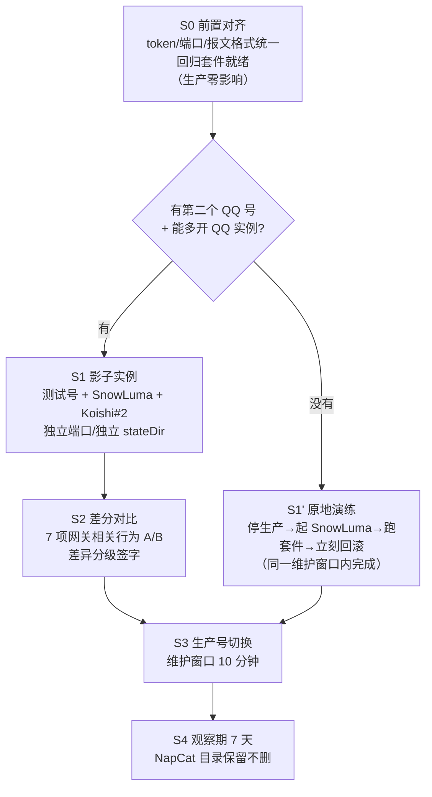

# SnowLuma 并跑灰度迁移方案（NapCat → SnowLuma）

> 编写时间：2026-10-30
> 基线：QQ 3.2.34-53644 + NapCat（LD_PRELOAD 注入，同进程）+ Koishi 4.18.11 + `deepseek.js`（829 行，19 项已修问题）
> 目标：**网关层**从 NapCat 迁到 SnowLuma，**Koishi + deepseek.js 零改动**，且 19 项历史修复全部不回归
> 原则：生产永不停摆超过一个维护窗口；任一阶段失败可 5 分钟内回滚；不碰已验证的逻辑代码

> ⚠️ **已选定路线 B，本文件仅保留通用分析（硬约束/不回归台账/风险表）。**
> 落地细化（免小号、三段式窗口、fork 构建策略、一键脚本）见：`/root/deploy/snowluma-route-b-plan.md`

---

## 0. 先明确三条硬约束（决定方案形态）

### 约束 1：同一个 QQ 号不能被两套注入器同时 hook

现网启动方式（`/opt/launcher.sh`）：

```
xvfb-run -a env LD_PRELOAD=./libnapcat_launcher.so /opt/QQ/qq --no-sandbox
```

NapCat 是**进程内注入**（实证：`3001`/`6099` 由 `/opt/QQ/qq` 进程 pid 50359 持有）。SnowLuma 同样是注入式
运行时（`packages/bridge` + `wrapper.linux.node`）。两套 hook 抢同一个 QQ 进程必然冲突；
且同一 QQ 号在两个客户端登录会互相踢下线。

**结论：同一时刻、同一号，只能有一个网关。** 真正的"并跑"必须用**第二个 QQ 号 + 第二个 QQ 实例**。

### 约束 2：插件状态键不含 botId，同群双 bot 会互相污染

`deepseek.js`：

```js
const channelKeyOf = (s) => `${s.platform||'onebot'}:${s.guildId||'private'}:${s.channelId||''}`;
const chatKeyOf    = (s) => `${channelKeyOf(s)}:${s.userId}`;
```

键里**没有 selfId**。若让生产号（NapCat）和测试号（SnowLuma）进**同一个群**：

| 污染项 | 后果 |
|---|---|
| `histories` | 两个 bot 共享同一份对话历史 |
| `groupBuffer` | `takeGroupContext()` 是"取完即删"，**先到先得**，另一个 bot 拿不到 @前上下文 |
| `activeUntil` | 任一 bot 被唤醒即点亮，另一个 bot 在非 @ 时也会抢答 → **双回复** |
| `chains` | 串行队列跨 bot 合并 |

**结论：灰度期间两个号必须**分群/分私聊对象**，或给 key 加 botId。
（加 botId 会改变键格式，导致 `/opt/koishi/state/deepseek/histories.json` 现有 21KB 历史全部失配 → 需迁移脚本，本方案**不改键格式**。）

### 约束 3：切换的真难点不是代码，是"配置漂移"

现网 Koishi 侧只有 2 个值绑定网关：

```js
endpoint: process.env.NAPCAT_WS_ENDPOINT || 'ws://127.0.0.1:3001',
token: '',
selfId:   process.env.NAPCAT_SELF_ID || '<BOT_UIN>',
```

NapCat 现在 `token` 为空、`messagePostFormat: array`、`reportSelfMessage: false`、`heartInterval: 30000`。
只要让 SnowLuma **在同样的端口、同样的 token、同样的报文格式**上提供服务，
切换就退化成"换个进程监听 3001"——Koishi 无需改配置、无需改 env。

**这就是整个方案的支点：S0 阶段先把"网关差异"前置对齐掉。**

---

## 1. 总体路线（两条，按能否拿到测试小号选）



- **路线 A（推荐）**：真并行，风险最低，但需要小号 + QQ 多开（Linux 双实例需 `--user-data-dir` + 独立 Xvfb display，待验证）。
- **路线 B（兜底）**：无小号时，用**自动化回归套件**替代并行验证，在维护窗口内"切一次、测一遍、不行就回滚"。
  窗口内可控中断 → 本质是 **10 分钟可回滚的灰度**，不是真正的 A/B。

两条路线共用 S0 与 S3/S4，只是中间验证手段不同。

> ✅ **本次采用路线 B** —— 完整执行手册见 **[第 13 节](#13-路线-b-专项执行手册无小号窗口制迁移)**。

---

## 2. 端口 / 目录 / 进程规划

| 角色 | 现在（生产） | S1/S2 灰度（路线 A） | S3 切换后（生产） |
|---|---|---|---|
| QQ 实例 | `/opt/QQ`（生产号 3904xxx410） | `/opt/QQ2`（测试小号，独立 Xvfb） | `/opt/QQ`（同号，改由 SnowLuma 拉起） |
| 网关 | NapCat，WS `0.0.0.0:3001` | SnowLuma，WS `127.0.0.1:3101` | SnowLuma，WS `127.0.0.1:3001` |
| 网关 WebUI | NapCat `:6099`（host `::`，公网可达 ⚠） | SnowLuma `:5199`（绑 127.0.0.1） | SnowLuma `:5099`（绑 127.0.0.1） |
| Koishi | `/opt/koishi`，`:5140` | `/opt/koishi-grey`，`:5240` | `/opt/koishi`，`:5140`（**零改动**） |
| stateDir | `/opt/koishi/state/deepseek` | `/opt/koishi-grey/state/deepseek` | 沿用原目录（历史无缝） |
| 日志 | `/opt/logs/{koishi,napcat}.log` | `/opt/logs/grey-{koishi,snowluma}.log` | `/opt/logs/{koishi,snowluma}.log` |
| 守护 | `qqbot-watchdog.service` | 独立 `qqbot-grey.service` | `qqbot-watchdog.service`（改拉 SnowLuma） |

> 端口 3001 是刻意保持一致的：S3 切换时 Koishi 的 `NAPCAT_WS_ENDPOINT` 不用动。
> SnowLuma 默认 HTTP `3000` / WS `3001`，与 NapCat 的 3001 **冲突**，灰度阶段必须显式改端口。

---

## 3. 不回归台账（19 项历史修复 × 依赖层 × 验收方法）

这是本次迁移的**验收总纲**，任何一项不通过 = 停止推进。

| # | 已解决的问题 | 所属层 | 是否受网关影响 | 验收方法 |
|---|---|---|---|---|
| 1 | `http`/`server` 插件必须加载 | Koishi | 否 | 启动日志无 `extend` 报错 |
| 2 | `@satorijs/core` 版本冲突（overrides 锁 4.6.1） | Koishi | 否 | `npm ls @satorijs/core` 单一版本 |
| 3 | nohup + watchdog 防掉线 | 运维 | **是** | 网关切换后 watchdog 能拉起 |
| 4 | 群聊 `retcode 1200` → 显式 `send_group_msg` | **网关** | **是** | 群聊真实发一条，`bot.internal.sendGroupMsg` 返回 ok |
| 5 | 白名单语义（空=放行） | 插件 | 否 | 套件断言 |
| 6 | 多轮上下文 + 持久化 | 插件 | 否 | 重启后 `histories.json` 恢复 |
| 7 | 频率闸 6/min、1500ms | 插件 | 否 | 套件断言 |
| 8 | 长回复分段 500×3 | 插件 | 否 | 套件断言 |
| 9 | Markdown → 纯文本 | 插件 | 否 | 套件断言 |
| 10 | 请求超时 60s、超时不重发 | 插件 | 否 | 套件断言（mock 超时） |
| 11 | 同会话串行队列 | 插件 | 否 | 套件断言 |
| 12 | 管理员指令 + 群聊开关 | 插件 | 否 | 真实 QQ `#状态` |
| 13 | 黑名单/敏感词/usage/持久化/撤回/引用回复 | 插件 | **部分** | 撤回依赖 `message-recall` 事件 |
| 14 | 热配置 hash 检测 5s | 插件 | 否 | 改 bot.env 观察日志 |
| 15 | CQ 码占位化（`[图片]`/`[语音]`/`[表情]`，`@` 保留） | **网关** | **是** | 发图片/语音/表情，看日志 |
| 16 | 引用读入（`session.quote`） | **网关** | **是** | QQ 内"回复"一条后 @ 机器人 |
| 17 | @前缓冲 + @后活跃窗口 120s | **网关** | **是** | 群内连发两条再 @ |
| 18 | 群发言人 `[QQ号 xxx]` 前缀 | 插件 | 否 | 日志/模型入参 |
| 19 | `server` 绑 `127.0.0.1`，不暴露公网 | Koishi | 否 | `ss -tlnp \| grep 5140` |

**真正需要重点验证的只有 7 项**（第 3/4/13 部分/15/16/17 项）。其余 12 项在 Koishi/插件层，
换网关理论上零影响——但仍要跑一遍，因为"理论上"不算验收。

### 网关强依赖的 7 个技术风险点

| 风险 | 现网依赖 | SnowLuma 需确认 |
|---|---|---|
| R1 群聊发送 | `bot.internal.sendGroupMsg(groupId, part, {message_id})` | 实现 `send_group_msg`，且支持 `message_id` 引用参数 |
| R2 引用读入 | `session.quote` ← adapter 内部 `get_msg` | 实现 `get_msg`，且返回结构与 NapCat 一致 |
| R3 撤回剔除 | `message-recall` 事件 + `messageId` | 事件名/结构一致；**message_id 为有符号 int32，负数合法**，历史里的旧 id 会失效 |
| R4 报文格式 | NapCat `messagePostFormat: array` | SnowLuma 需同样输出 array 段格式（否则 CQ 码解析路径不同） |
| R5 @ 识别 | `element.type === 'at'` + `content.includes('@'+selfId)` | at 段结构一致 |
| R6 心跳重连 | `heartInterval 30000` / `reconnectInterval 5000` | 断线重连行为一致 |
| R7 媒体 URL | `[CQ:image]` → `[图片]` 占位（不下载） | 段类型名一致（`image`/`record`/`video`/`face`） |

---

## 4. S0：前置对齐（**生产零影响，可立刻做**）

目的：把"切换时需要改的东西"提前改掉并单独观察，让 S3 退化为纯进程替换。

### S0.1 备份（改动前）

```bash
TS=$(date +%Y%m%d-%H%M%S)
cp /opt/koishi/koishi.config.js /root/deploy/koishi.config.js.bak-s0-$TS
cp /opt/bot-watchdog.sh       /root/deploy/bot-watchdog.sh.bak-s0-$TS
cp /root/deploy/bot.env       /root/deploy/bot.env.bak-s0-$TS
cp /opt/napcat/config/onebot11_<BOT_UIN>.json /root/deploy/onebot11.bak-s0-$TS.json
```

### S0.2 网关 WS token 对齐（关键一步）

现状：NapCat `token: ""`，Koishi 硬编码 `token: ''`。
SnowLuma **默认强制生成 accessToken**，若不对齐，S3 切换时必须改 Koishi 配置。

做法：
1. 生成固定 token 写入 `bot.env`：`export NAPCAT_WS_TOKEN="<32位随机>"`
2. NapCat `onebot11_<BOT_UIN>.json` 的 `websocketServers[0].token` 设为同值
3. Koishi 改为 `token: process.env.NAPCAT_WS_TOKEN || ''`
4. 按第九节流程重启，验证 `adapter connect` 正常

> 这一步**与 SnowLuma 无关**，是纯粹的配置规范化。建议改完先跑 24 小时，确认无副作用，
> 再进入 S1。这样 S3 切换时 Koishi 侧完全不动。

### S0.3 端口收敛

同一时间只监听 3001（由约束 1 天然保证）。额外把 NapCat 的 WS `host` 从 `0.0.0.0`
改成 `127.0.0.1`（当前 `0.0.0.0:3001` 与 `6099` 对公网暴露，属遗留安全问题；
注意改完需确认 Koishi 仍能连上）。SnowLuma 侧从一开始就配 `127.0.0.1`。

### S0.4 基线快照（用于 S2 差分对比）

```bash
mkdir -p /root/deploy/migrate/baseline
# 进程 / 端口 / 环境（脱敏）
ps -eo pid,args | grep -E 'QQ|koishi' > /root/deploy/migrate/baseline/ps.txt
ss -lntup | grep -E ':3001|:5140|:6099' > /root/deploy/migrate/baseline/ports.txt
tr '\0' '\n' < /proc/$(pgrep -f 'koishi/lib/worker')/environ \
  | grep -E '^BOT_|^DEEPSEEK_|^NAPCAT_' | sed 's/=.*KEY.*/=<redacted>/' \
  > /root/deploy/migrate/baseline/env.txt
# 行为基线：抓一段真实日志
tail -500 /opt/logs/koishi.log > /root/deploy/migrate/baseline/koishi-tail.log
```

### S0.5 回归套件（本次迁移的核心资产）

要求：**离线可跑、不碰生产、不烧 token**。启动时先清空继承的 `BOT_*` 环境变量
（历史教训：真实白名单会干扰断言）。

用例清单（沿用既有冒烟风格 10/10 + 8/8）：

```
A 组：插件逻辑（换网关也必须全绿）
  A1  群聊未 @ 不回复
  A2  群聊 @ 后长回复分段（parts<=3，单段<=500）
  A3  白名单私聊有回复 / 非白名单被拦截
  A4  黑名单压制管理员
  A5  敏感词输入拦截 + 输出拦截（不写历史）
  A6  频率闸：第 2 条被丢弃
  A7  最小间隔：第 2 条被丢弃
  A8  同会话串行（并发两条不乱序）
  A9  Markdown→纯文本、CQ 占位化（[图片]/[语音]/[表情]）
  A10 管理员 #状态 / #重置对话（含群聊开关关/开）
  A11 历史持久化往返（写→读→深拷贝）
  A12 撤回剔除（按 msgId）
  A13 热配置 hash：同内容不触发 / 改内容必触发
  A14 @前缓冲 + @后活跃窗口（activeWindowMs=0 时退化为纯 @）

B 组：网关契约（S1/S1' 专用，连真实 SnowLuma）
  B1  send_group_msg 返回 retcode 0（对应第 4 项）
  B2  get_msg 返回被引用原文，session.quote 有 content/userId/username（第 16 项）
  B3  message-recall 事件能定位到 msgId（第 13 项）
  B4  图片/语音/表情段 type 名与 NapCat 一致（第 15 项）
  B5  未 @ 消息进 groupBuffer、@ 后被消费（第 17 项）
  B6  断线自动重连（kill 网关进程，观察 Koishi 侧 reconnect）
  B7  心跳 30s 正常，`#状态` 可用
```

A 组用 mock 驱动插件；B 组用 `/tmp/grey` 里的测试群/测试号真流量。

**Gate S0**：token 对齐后 24h 无异常 + A 组 14/14 全绿。

---

## 5. S1：影子实例（路线 A）

### 步骤

1. **SnowLuma 落位**（独立目录，不碰 NapCat）

   ```
   /opt/snowluma/            # 发行包解压
   /opt/snowluma/config/onebot_<小号>.json
   ```

2. **SnowLuma 配置对齐**（对应 R4/R6）

   ```jsonc
   // 目标：与 NapCat 现配置语义一致，仅端口不同
   {
     "network": {
       "websocketServers": [{
         "name": "koishi-grey",
         "enable": true,
         "host": "127.0.0.1",        // ⚠ 不学 NapCat 的 0.0.0.0
         "port": 3101,
         "token": "<同 S0.2 的 token>",
         "messagePostFormat": "array",
         "reportSelfMessage": false,
         "heartInterval": 30000
       }]
     }
   }
   ```

   WebUI 端口改 5199 并绑 127.0.0.1。

3. **第二 QQ 实例**（Linux 多开，**待验证项**）

   ```
   /opt/QQ2/                        # QQ 安装副本
   xvfb-run -a -n 99 env DISPLAY=:99 <snowluma launcher> --user-data-dir=/opt/QQ2-data
   ```

   若 QQ 3.2.34 Linux 版不支持 `--user-data-dir` 多开 → **路线 A 不可行，降级路线 B**。

4. **Koishi#2**

   ```bash
   cp -a /opt/koishi /opt/koishi-grey          # 或软链 node_modules
   # /opt/koishi-grey/koishi.config.js 只改：
   #   KOISHI_PORT=5240
   #   NAPCAT_WS_ENDPOINT=ws://127.0.0.1:3101
   #   NAPCAT_SELF_ID=<小号>
   #   BOT_STATE_DIR=/opt/koishi-grey/state/deepseek
   #   BOT_ALLOWED_USERS/GROUPS 只放测试号 + 测试群
   ```

5. **独立守护**：`qqbot-grey.service` → `/opt/grey-watchdog.sh`（拉 SnowLuma + Koishi#2），
   `WantedBy=` 留空（不随机启动）。

**Gate S1**：B 组 7/7 通过 + A 组 14/14 在灰度实例上复跑通过 + 连续运行 48h 无异常退出。

---

## 6. S2：差分对比（A/B 台账）

同一批用例分别在 NapCat（生产）与 SnowLuma（灰度）上执行，填表：

| 用例 | NapCat 结果 | SnowLuma 结果 | 判定 |
|---|---|---|---|
| 群聊 @ 回复（retcode） | ok / 0 | ? | 必须一致 |
| 引用某条后 @ 机器人 | 看到原文 | ? | 必须一致 |
| 撤回一条被回复的消息 | 历史剔除 | ? | 必须一致 |
| 图片消息 | `[图片]` | ? | 必须一致 |
| 表情 / 语音 / 视频 | `[表情]`/… | ? | 必须一致 |
| 未 @ 两条再 @ | 看到前文 | ? | 必须一致 |
| 私聊连续 8 轮 | 轮次 1..8 | ? | 必须一致 |
| 心跳断开重连 | 自动 | ? | 可接受差异（记录） |
| `message_id` 符号 | 正数 | 可能为负 | **可接受**，但需确认插件不依赖正数 |
| 超长消息分段 | 3 段 | ? | 必须一致 |

差异分三级：
- 🔴 **阻断**：任一"必须一致"项不符 → 停止，报差异给对方/自行修 adapter。
- 🟡 **可接受**：记录并在 S4 观察。
- 🟢 **改进**：SnowLuma 更优（如 message_id 严谨性、WS 绑 127.0.0.1）。

**Gate S2**：🔴 为 0，且 🟡 均已书面确认不影响 19 项台账。

---

## 7. S3：生产号切换（维护窗口）

前提：S0/S1/S2 全绿；NapCat 全目录已备份；SnowLuma 配置已用同号预置好。

时间预算 **≤10 分钟**，全程可回滚：

```bash
# T+0  停守护（否则守护 20s 后会把 NapCat 拉回来）
systemctl stop qqbot-watchdog

# T+1  杀全部旧进程（注意 k[o]ishi / n[o]de 写法，避免误杀自身 shell）
pkill -f "b[o]t-watchdog\.sh"
pkill -f "k[o]ishi start"; pkill -f "k[o]ishi/lib/worker"
pkill -f "/opt/QQ/qq --no-sandbox"
pkill -f "napcat_launcher"
sleep 3
ss -lntup | grep -E ':3001|:5140'          # 必须为空

# T+3  起 SnowLuma（同号，占 3001）
cd /opt/snowluma && nohup ./launcher.sh >> /opt/logs/snowluma.log 2>&1 &
sleep 25
ss -lntup | grep ':3001'                   # 应为 127.0.0.1:3001

# T+5  起 Koishi（配置未改动）
cd /opt/koishi && nohup node ./node_modules/.bin/koishi start koishi.config.js \
  >> /opt/logs/koishi.log 2>&1 &
sleep 12

# T+6  重启守护（需先把脚本改为拉 SnowLuma，见 S3.1）
systemctl start qqbot-watchdog

# T+7  验收
grep -E "adapter connect|白名单|管理员|上下文" /opt/logs/koishi.log | tail -5
grep -iE "error|failed" /opt/logs/snowluma.log | head -20
```

### S3.1 守护脚本改造（切换前预置好，避免现场改）

`/opt/bot-watchdog.sh` 里 `start_napcat()` 改为 `start_gateway()`：

- 进程探测：`pgrep -f 'snowluma'`（而非 `/opt/QQ/qq`，因为 QQ 现在由 SnowLuma 拉起）
- 启动：`cd /opt/snowluma && nohup ./launcher.sh &`
- 其余（Koishi 拉起逻辑、20s 循环）**完全不动**

建议做成**开关式**，而不是直接重写：

```bash
GATEWAY=${BOT_GATEWAY:-napcat}      # napcat | snowluma
```

这样回滚只需改一行环境变量 + 重启守护。

### S3.2 现场验收（人工，5 分钟内）

按台账逐项打勾，重点 7 项：

- [ ] 群里 @ 一次 → 有回复（R1）
- [ ] 回复某条消息再 @ → 机器人提到"引用"内容（R2）
- [ ] 撤回一条 → 历史被剔除（日志可见）（R3）
- [ ] 发一张图 → 日志出现 `[图片]`（R7）
- [ ] 未 @ 说两句再 @ → 回复体现前文（R5）
- [ ] 私聊连发 3 轮 → 轮次递增（多轮）
- [ ] `#状态` → 返回正常（管理员）

**任一不过 → 立即执行第 10 节回滚。**

---

## 8. S4：观察期（7 天）

- NapCat 目录 `/opt/napcat`、`/opt/QQ`、`libnapcat_launcher.so`、`onebot11_*.json` **一律不删**。
- 守护脚本保留 `BOT_GATEWAY` 开关，回滚 = 改一行 + 重启。
- 每日检查：
  ```bash
  grep -cE "发送失败|发送结果未知" /opt/logs/koishi.log     # 应为 0 增量
  grep -cE "重连|reconnect" /opt/logs/koishi.log            # 记录基线
  du -sh /opt/koishi/state/deepseek                          # 历史文件不异常膨胀
  ```
- 7 天无异常 → 归档本方案 + 在 `ds-roobot-dev.md` 追加"第十六节：网关迁移 SnowLuma"。
- 30 天后仍稳定 → 再考虑删除 NapCat 资产（可选）。

---

## 9. 回滚（三档，均 ≤5 分钟）

### 档 1：切换后网关异常（最常见）

```bash
systemctl stop qqbot-watchdog
pkill -f "b[o]t-watchdog\.sh"
pkill -f "k[o]ishi start"; pkill -f "k[o]ishi/lib/worker"
pkill -f "snowluma"; pkill -f "/opt/QQ/qq --no-sandbox"
sleep 3
sed -i 's/^export BOT_GATEWAY=.*/export BOT_GATEWAY="napcat"/' /root/deploy/bot.env
systemctl start qqbot-watchdog
```

### 档 2：Koishi 侧异常（网关没问题）

```bash
cp /root/deploy/koishi.config.js.bak-s0-<TS> /opt/koishi/koishi.config.js
# 按第九节流程重启
```

### 档 3：历史/状态异常

```bash
cp -a /root/deploy/migrate/state-backup/deepseek /opt/koishi/state/
```

> 切换前必须做：`cp -a /opt/koishi/state/deepseek /root/deploy/migrate/state-backup/`

---

## 10. 风险与熔断

| 风险 | 概率 | 影响 | 熔断条件 |
|---|---|---|---|
| Linux QQ 不支持多开 → 路线 A 不可行 | 中 | 只能走路线 B | S1 步骤 3 验证失败即降级 |
| SnowLuma 的 `get_msg` 结构与 NapCat 不同 → 引用读入失效 | 中 | 第 16 项回归 | B2 用例失败即阻断 |
| `message_id` 为负 → 历史旧 id 撤回失效 | 中 | 仅影响旧消息 | 可接受（新消息正常） |
| SnowLuma 需特定 QQ 版本（3.2.34 不在兼容清单） | 中 | 无法启动 | 先查 `compat/` 清单 |
| headless 下 launcher 起 QQ 失败 | 中 | 无法启动 | 用 `xvfb-run` 包裹验证 |
| Koishi `bot.internal.sendGroupMsg` 在 SnowLuma 下不可用 | 低 | 第 4 项回归 | B1 失败即阻断 |
| 许可问题（非商业自托管） | 低 | 合规 | 商用需书面授权 |

**总熔断**：S2 出现 🔴，或 S3 现场 7 项有 2 项以上不过 → 终止迁移，回滚，方案归档。

---

## 11. 工作量估算

| 阶段 | 人力 | 说明 |
|---|---|---|
| S0 前置对齐 | 0.5 天 + 24h 观察 | 纯配置，零风险 |
| S0.5 回归套件 | 1 天 | 最大头，但可复用 |
| S1 影子实例 | 1~2 天 | 多开是最大不确定项 |
| S2 差分对比 | 0.5 天 | 填表 |
| S3 切换 | 10 分钟窗口 | 需人在场 |
| S4 观察 | 7 天被动 | — |

**总计约 3~4 个工作日 + 7 天观察。**

---

## 12. 一句话结论

> 迁移的真正工作量不在"换网关"，而在**把网关差异提前对齐（token/端口/报文格式）**
> 和**用回归套件证明 19 项历史修复没有回归**。
> S0 做完之后，切换本身只是"换个进程监听 3001"——而这件事 5 分钟内可以撤回。
